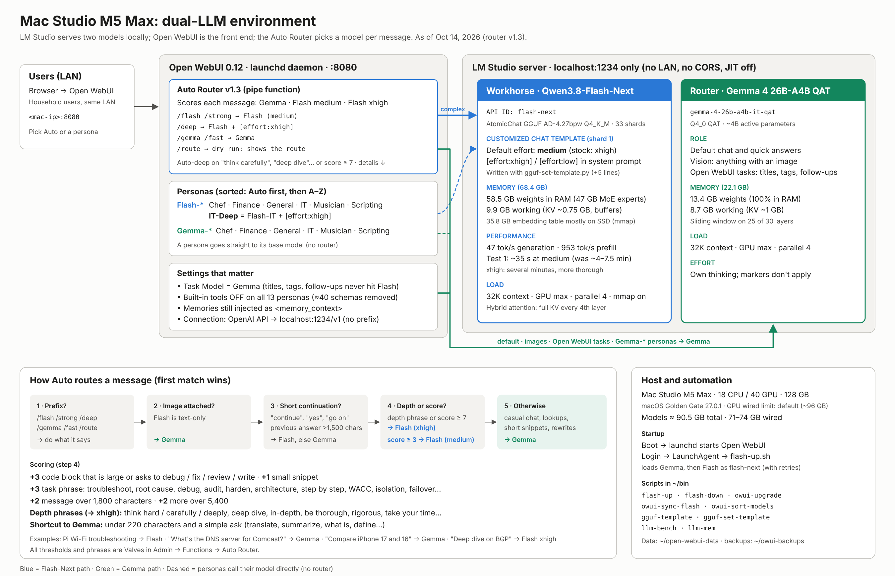
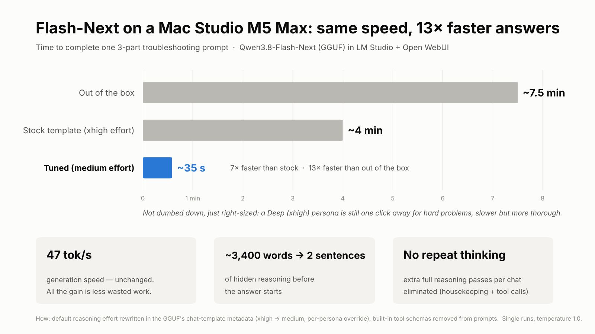

# MacLLM: dual-LLM stack on a Mac Studio M5 Max

Local LLM setup that runs two models side by side in LM Studio behind Open WebUI, with a scoring router that picks a model (and reasoning effort) per message. Everything runs on the Mac; the LM Studio API is localhost-only.



## Stack

| Component | Setting |
| --- | --- |
| Hardware | Mac Studio M5 Max (18 CPU / 40 GPU), 128 GB, 1 TB, macOS 27.0.1 |
| Workhorse | `flash-next` = AtomicChat `Qwen3.8-Flash-Next-AD-4.27bpw-Q4_K_M-M64` (33-shard GGUF, 88 GB of weights) |
| Router / vision / tasks | `gemma-4-26b-a4b-it-qat` (13.4 GB) |
| Load settings | 32K context, GPU max, parallel 4, mmap on (Flash: Keep in Memory off) |
| Server | LM Studio on `localhost:1234` only; no LAN binding, no CORS, JIT off |
| Front end | Open WebUI 0.12, launchd daemon on `:8080`, data in `~/open-webui-data` |
| GPU wired limit | macOS default (`iogpu.wired_limit_mb` = 0, ~96 GB) |

## Measured (Oct 15, 2026)

| | Flash-Next | Gemma 4 26B |
| --- | --- | --- |
| Generation | 48.3 tok/s | 125.4 tok/s |
| Prefill (~7.8K tokens) | 942 tok/s | 3,618 tok/s |
| Time to first token | 253 ms | 112 ms |
| Generation @ 28K context (Oct 16) | 44.9 tok/s (−7%) | 90.7 tok/s (−27%) |
| Prefill @ 28K context (Oct 16) | 909 tok/s, 31 s TTFT | 2,805 tok/s, 10 s TTFT |
| Peak wired while generating (Oct 16) | 72.3 GB | 20.7 GB |
| Both busy (Gemma vision + Flash, Oct 16) | 28.7 tok/s, 26.8 @ 28K | 62.1 tok/s |
| Memory (weights + working) | 58.4 + 8.1 = 66.5 GB | 13.4 + 9.1 = 22.5 GB |

Idle baseline is ~18 GB wired; with both models generating at once, peak wired is 75.8 GB (no swap, pressure normal), well under the ~96 GB default limit. Contention costs speed, not memory: each model loses 40–50% while the other is busy.

Both models together: ~89 GB real memory (`llm-mem.py`). Flash's 35.8 GB per-layer embedding table stays mostly on SSD via mmap (~6 GB resident).

Test 1 (3-part Raspberry Pi Wi-Fi troubleshooting prompt), end to end: ~7.5 min out of the box → ~4 min after prompt cleanup → **~35 s** at medium effort. Generation speed never changed; the gain is less wasted reasoning.



## Effort control

Flash-Next's stock chat template forces `xhigh` reasoning, LM Studio ignores `reasoning_effort` in requests, and its Chat Template box blocks paste. The template inside GGUF shard 1 was rewritten instead (`m5/bin/gguf-set-template.py`): default `medium`; `[effort:xhigh]` or `[effort:low]` in the first system message overrides it.

Ways to get xhigh: the Flash-IT-Deep persona; `[effort:xhigh]` in a persona or a chat's system prompt; `/deep` in Auto; or automatically in Auto (depth phrases such as "think carefully" / "deep dive", or a routing score of 7+).

Reapply after a model re-download (templates: `m5/templates/`):

```bash
cd ~/.lmstudio/models/AtomicChat/Qwen3.8-Flash-Next-AD-4.27bpw-Q4_K_M-M64
~/.lmstudio/bin/lms unload flash-next
python3 ~/bin/gguf-set-template.py Qwen3.8-Flash-Next-AD-4.27bpw-Q4_K_M-M64-00001-of-00033.gguf ~/flash-next-template-medium.jinja ~/shard1-new.gguf
python3 ~/bin/gguf-template.py ~/shard1-new.gguf | grep -c effort_ns
mv ~/shard1-new.gguf Qwen3.8-Flash-Next-AD-4.27bpw-Q4_K_M-M64-00001-of-00033.gguf
~/bin/flash-up.sh
```

Verify with `~/.lmstudio/bin/lms log stream`: a plain request shows no "Reasoning effort is set" line; an `[effort:xhigh]` request does.

## Auto Router (`m5/openwebui/auto_router.py`, v1.3.1)

Paste into Open WebUI → Admin → Functions. Routing, first match wins:

1. Prefix: `/flash` `/strong` → Flash (medium); `/deep` → Flash + `[effort:xhigh]`; `/gemma` `/fast` → Gemma; `/route` → dry run that reports the route.
2. Image attached → Gemma (Flash is text-only).
3. Short continuation ("continue", "yes") → Flash if the previous answer was long, else Gemma.
4. Depth phrase or score ≥ 7 → Flash (xhigh); score ≥ 3 → Flash (medium). Scoring: +3 code task, +3 task phrase (troubleshoot, root cause, audit, WACC…), +2 over 1,800 chars, +2 more over 5,400.
5. Otherwise → Gemma.

The router never sends `reasoning_effort`. Thresholds and phrase lists are valves.

## Open WebUI setup

- Connection: OpenAI API `http://localhost:1234/v1`, no prefix; Ollama and Direct Connections off.
- Task Model: Gemma (titles, tags, follow-ups never hit Flash).
- Personas: Flash-* (Chef, Finance, General, IT, IT-Deep, Musician, Scripting) and Gemma-* (same set minus IT-Deep), plus Auto. Built-in tools off on all of them.
- Dropdown order: Auto first, then A–Z (`owui-sort-models.sh`).
- Scripts authenticate with a login token; put `OWUI_EMAIL` in `~/.config/macllm.env` (see `env.example`).

## Daily operations

| Task | Command |
| --- | --- |
| Start / reload both models | `~/bin/flash-up.sh` |
| Stop everything | `~/bin/flash-down.sh` |
| Upgrade Open WebUI (with backup and rollback) | `~/bin/owui-upgrade.sh` |
| Benchmark | `python3 ~/bin/llm-bench.py --model flash-next` |
| Benchmark at depth, with memory | `python3 ~/bin/llm-bench.py --model flash-next --long-ctx 28000 --mem` |
| Benchmark under combined load | add `--load-model gemma-4-26b-a4b-it-qat --load-image ~/Pictures/test.png` |
| Memory per model | `python3 ~/bin/llm-mem.py` |
| Watch requests | `~/.lmstudio/bin/lms log stream` |
| Copy a persona setting to sibling personas | `owui-sync-flash.sh` (report → dry run → `DRY_RUN=0`) |
| Re-sort dropdown | `~/bin/owui-sort-models.sh` |
| See where Auto would send a message | `/route <message>` in a throwaway Auto chat |

## Repo layout

| Path | Contents |
| --- | --- |
| `m5/bin/` | Scripts linked into `~/bin` by `install.sh` |
| `m5/launchd/` | Login LaunchAgent template (rendered to `com.$USER.flash-up`) |
| `m5/openwebui/` | Open WebUI functions (router, filter) |
| `m5/templates/` | Stock and edited Flash-Next chat templates |
| `m1/` | Gemma-only installer and scripts for a 32 GB M1 Max Studio |
| `docs/images/` | Diagram and efficiency chart |
| `CHANGELOG.md` | Dated history of changes and measured results |

Install or update on the Mac: `./install.sh` (dry run), then `./install.sh --apply` (add `--launchd` to install the login agent).

## Never commit

Model weights, `~/open-webui-data`, Open WebUI exports or backups (they contain chats, memories and personal prompts), tokens, API keys, AWS credentials. `.gitignore` covers the common cases.

## Gotchas

- zsh: `#` is not a comment in pasted commands, `<placeholder>` text is read as a redirect, and `echo` turns `\n` inside JSON into real newlines; read JSON files with `jq` directly.
- A model re-download restores the stock template (xhigh). Leave LM Studio's Chat Template box at default.
- `lms ps` shows file size, not memory. `top`'s "used" includes file cache; wired is ~19 GB after reboot and 70–74 GB once Flash runs.
- Open WebUI valves: click "Custom" to flip a valve back to Default; saved valve values survive a function code update.
- launchctl: wait ~5 s after `bootout` before `bootstrap`.
- Folders: `~/ZuulRulez` stays on MacLLM (`~/bin` links point into it; never `git checkout` there). Monitor work goes in `~/ZuulRulez-monitor` (git worktree).
